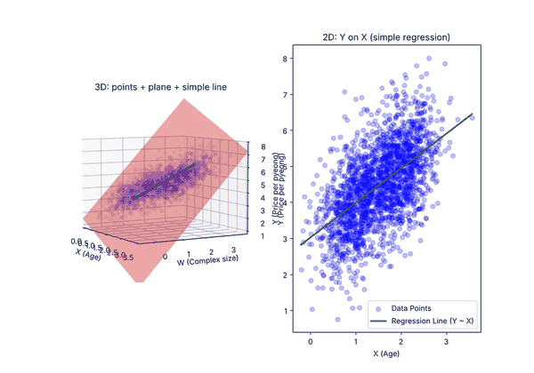
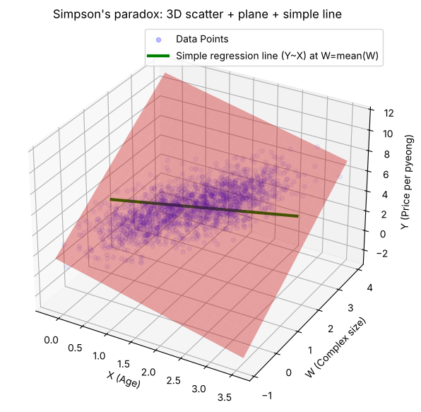
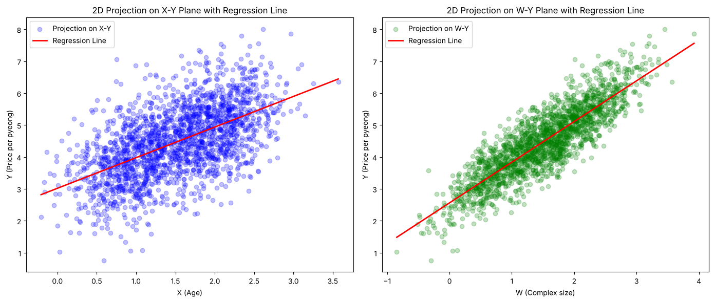

# Simpson's Paradox in Linear Regression

A small simulation of how a regression coefficient can **change sign** depending on whether a correlated variable is controlled for.

<p align="center">
  
</p>

## Setup

Synthetic data (N = 2,000, seed 42) loosely framed as apartment prices:

| Variable | Meaning | How it is generated |
|---|---|---|
| `X` | building age | mixture of two clusters around 1 and 2, plus N(0, 0.4) |
| `W` | complex size | `X` + N(0, 0.4), so strongly correlated with `X` |
| `Y` | price per pyeong | `Y = 3 − 1·X + 2·W + ε`, ε ~ N(0, 0.4) |

Holding complex size fixed, older buildings are cheaper. But older buildings also tend to be in larger complexes, and larger complexes are more expensive.

## Result

| Model | Slope on `X` |
|---|---:|
| Multiple regression `Y ~ X + W` | **−1.051** (true value −1) |
| Simple regression `Y ~ X` | **+0.960** |

The simple-regression slope is not wrong; it answers a different question. It is the *total* effect along the path where `W` moves together with `X`:

$$
\underbrace{0.960}_{\text{simple slope}} \;=\; \underbrace{-1.051}_{b_X\ \text{(hold W fixed)}} \;+\; \underbrace{2.044}_{b_W} \times \underbrace{0.983}_{dW/dX}
$$

<p align="center">
  
  
</p>

Projected onto the (X, Y) plane, the data shows a clear positive trend, even though every slice with fixed `W` slopes downward.

## What I learned

The same data can support opposite conclusions depending on which variables are held fixed. Before trusting a coefficient (or a metric), it is worth checking what was conditioned on and how the data was aggregated.

## Run it

```bash
pip install -r requirements.txt
jupyter notebook simpsons_paradox_regression.ipynb
```

The last cell writes the rotating GIF to `assets/`.
